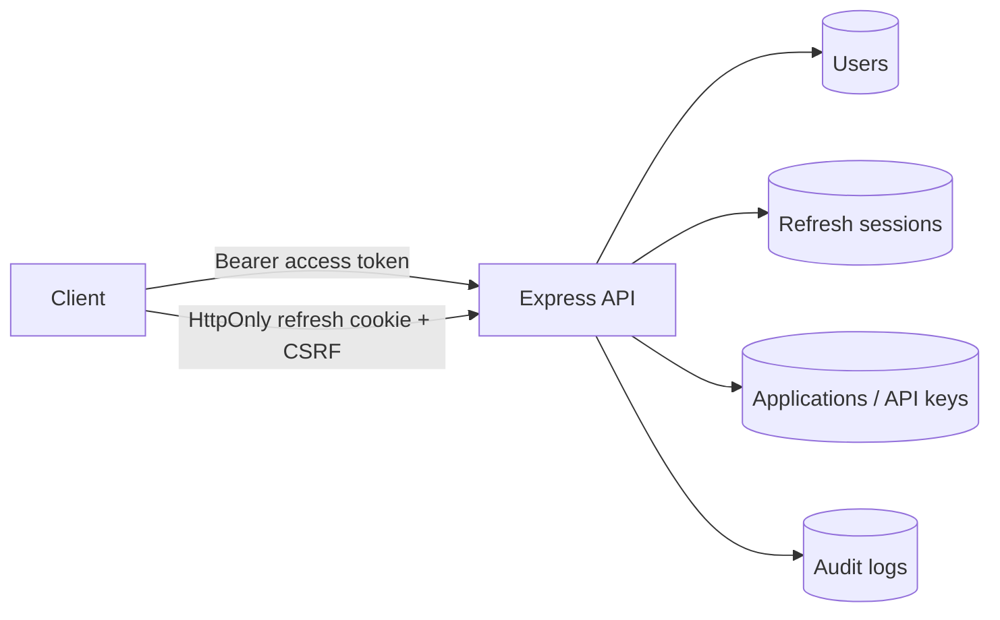

# AuthKit

AuthKit is a multi-tenant authentication service built with Express and MongoDB. It provides password authentication, verified-email and recovery flows, rotating refresh sessions, application-scoped identities, hashed API keys, RBAC, audit records, OpenAPI documentation, Docker packaging, and CI checks.

## Quick start

1. Copy `.env.example` to `.env` and provide `MONGO_URI` plus a long `JWT_ACCESS_SECRET`.
2. Run `npm install`, then `npm run dev`.
3. Browse API documentation at `http://localhost:5000/api/docs`.

## Architecture

## Security notes

- Passwords and application secrets are never stored in plaintext.
- Refresh tokens are SHA-256 hashed, atomically consumed, rotated, and family-revoked on reuse.
- Access tokens are short-lived JWTs; password changes invalidate all refresh sessions.
- `DEV_EXPOSE_EMAIL_TOKENS=true` is only for local testing and must never be used in production.
- Existing databases that retain the old unique `email_1` index must drop that index before application-scoped duplicate emails are supported; take a backup and perform this migration deliberately.

## Deployment

Build locally with `docker compose up --build`. For Render/Railway, use `npm start`, set all environment variables from `.env.example`, configure `CLIENT_URL` to the deployed frontend, and use HTTPS so refresh cookies are secure.

Google OAuth configuration is documented in [docs/google-oauth.md](docs/google-oauth.md).
